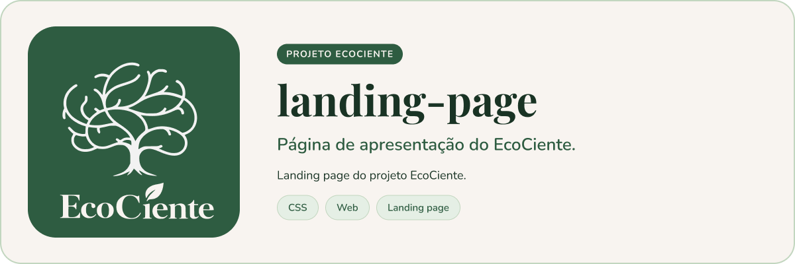

<p align="center">
  
</p>

# landing-page


Repositório responsável pela landing page do EcoCiente, apresentando o projeto, seus objetivos e principais informações de forma clara e acessível.

## Executando

O site é estático e não precisa de build: abra o `index.html` no navegador ou sirva a pasta com qualquer servidor estático.

```bash
git clone https://github.com/EcoCiente-Instituto-J-F/landing-page.git
cd landing-page
python -m http.server 8000   # http://localhost:8000
```

## Estrutura do projeto

```
.
├── index.html     # página única
├── style.css      # estilos
├── assets/        # imagens, ícones e logotipos
└── .github/pull_request_template.md
```

## Contribuindo

Leia o [CONTRIBUTING.md](CONTRIBUTING.md) antes de abrir uma Pull Request. Ao participar, você concorda com o [Código de Conduta](CODE_OF_CONDUCT.md).

## Segurança

Encontrou uma vulnerabilidade? Siga o [SECURITY.md](SECURITY.md). **Não abra issue pública.**

## Licença

Este projeto está sob a licença MIT. Veja o arquivo [LICENSE](LICENSE).
